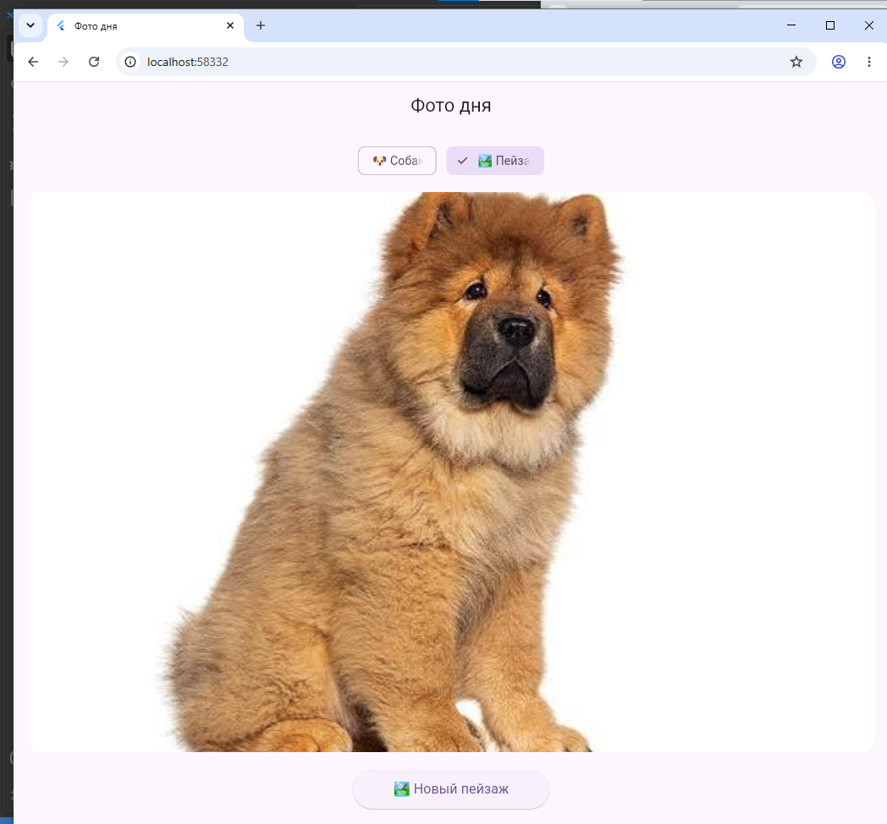

# Лабораторная работа №8. Асинхронность в Dart и Flutter

приложение «Фото дня» на flutter — экран с выбором категории и кнопкой, которая асинхронно загружает случайные фотографии с индикатором загрузки

## Автор
Резник Анжелика Ильинична, группа ИСП-242

## Стек и версии
* Flutter SDK: 3.50.0 (Dart 3.14.0)
* Платформа: Web (Chrome)
* Пакет: `http: ^1.6.0`

## Скриншот приложения

## Что изучили
* как работает асинхронность в dart через Future<T>, async и await, чтобы интерфейс не зависал при ожидании
* как отправлять http-запросы через пакет http и парсить json-ответы с помощью jsonDecode()
* как обрабатывать ошибки при загрузке через try / catch
* как выводить локальные картинки из папки assets через Image.asset

## Ответы на вопросы

1. **Что такое `Future<T>`? Чем отличается от обычного возвращаемого значения?**
`Future<T>` — это объект-обещание, который говорит, что результат типа T появится позже в будущем (например, когда придёт ответ от сервера или закончится задержка). обычное возвращаемое значение функция отдаёт сразу в момент вызова

2. **Что делает await? Блокирует ли он весь поток выполнения?**
`await` приостанавливает выполнение текущей асинхронной функции и ждёт, пока `Future` завершится. весь поток программы он не блокирует — интерфейс остаётся живым и крутится индикатор загрузки

3. **Зачем `setState()` вызывается дважды в `_fetchPhoto()`?**
первый вызов ставит `_isLoading = true` и сбрасывает старое фото, чтобы сразу показать крутилку загрузки. второй вызов в конце ставит `_isLoading = false`, чтобы убрать крутилку и отобразить картинку или текст ошибки

4. **Почему кнопке передаётся `_fetchPhoto` без скобок, а не `_fetchPhoto()`?**
без скобок передаётся сама ссылка на функцию, чтобы flutter вызвал её только при нажатии на кнопку. со ско скобками `_fetchPhoto()` функция вызвалась бы сразу при отрисовке экрана

5. **Чем `Image.network()` отличается от `Image.asset()`?**
`Image.network()` загружает картинку по ссылке из интернета (URL), а `Image.asset()` берёт локальный файл прямо из папки ресурсов внутри самого проекта

## Запуск
1. git clone https://github.com/Anzhela2014/lab8mob
2. cd lab8mob/Flutter/photo_of_the_day_reznik
3. flutter pub get
4. flutter run -d chrome